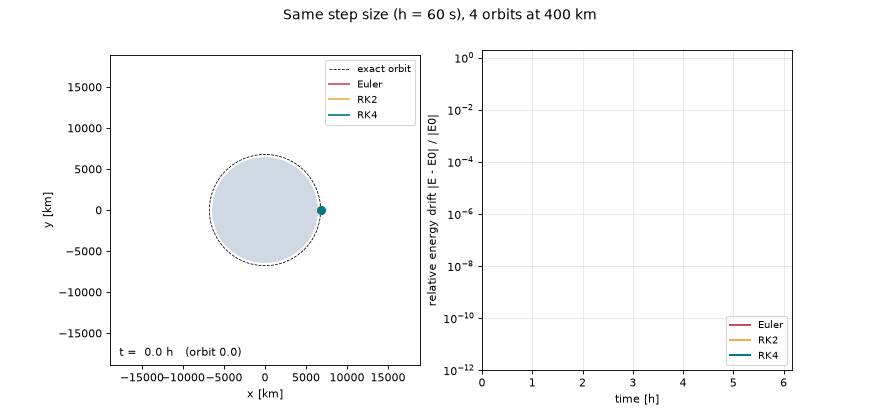
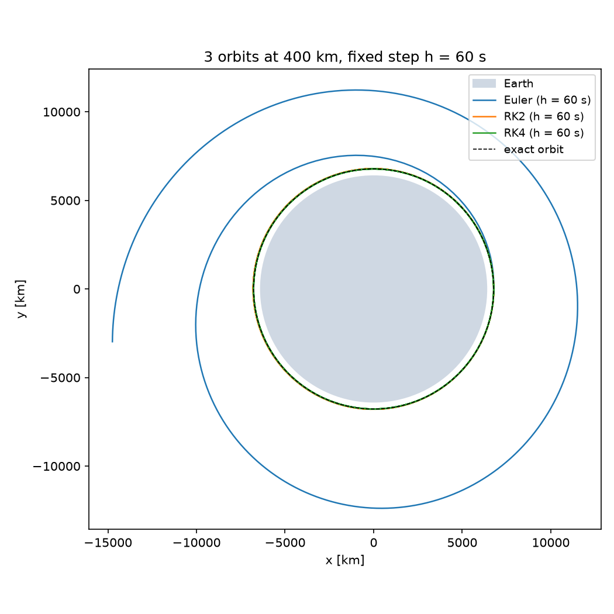
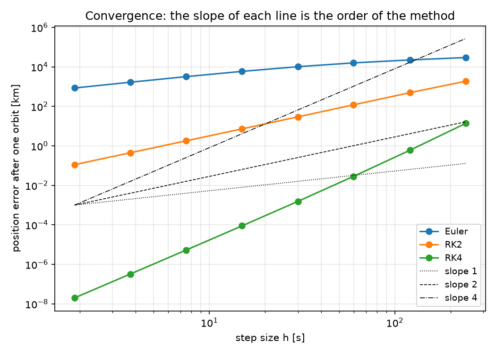
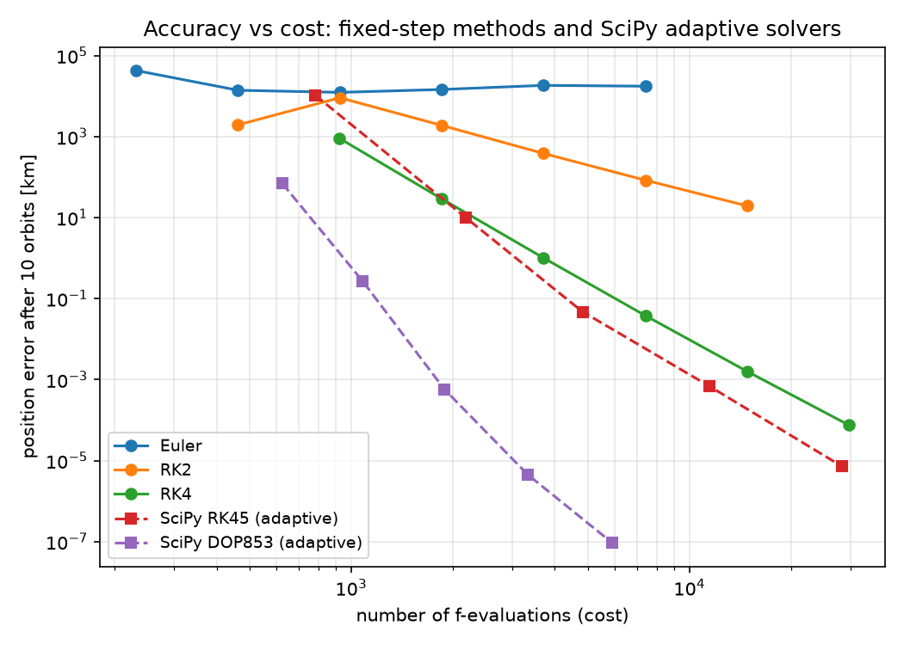

# Two-Body Orbit Propagation: Euler, RK2, RK4 and Adaptive Solvers



*Same step size for all methods: Euler spirals outwards and gains energy, RK4 stays on the orbit.*

A small study of numerical integrators on the simplest orbit problem there is: a satellite in a circular low Earth orbit. Because the exact solution is known, every error can be measured precisely, which makes it a clean test bed for comparing methods.

The study covers:

1. the physics and how it becomes an ordinary differential equation (ODE),
2. three fixed-step integrators written from scratch (Euler, RK2, RK4),
3. how their error behaves, measured against the exact solution,
4. a comparison with SciPy's adaptive solvers (RK45, DOP853).

```
orbit_rk.py     physics, integrators, experiments (accuracy and convergence order)
analysis.py     static figures and the SciPy comparison
animate.py      animated orbits and energy drift (GIF)
figures/        generated plots
```

```bash
uv sync                 # install dependencies from uv.lock
uv run orbit_rk.py      # tables: accuracy and observed order
uv run analysis.py      # figures + SciPy comparison
uv run animate.py       # figures/orbits_energy.gif
```

---

## 1. Physics: from Newton to an ODE

### 1.1 The two bodies

The two bodies are Earth (mass $M$) and a satellite (mass $m$). In general both move around their common centre of mass. For a satellite, $m \ll M$ (a few hundred kilograms against $6 \times 10^{24}$ kg), so the centre of mass is practically at Earth's centre. We place Earth at the origin and only follow the satellite.

The position vector $\mathbf{r}$ points from Earth's centre to the satellite, and $\mathbf{v} = \dot{\mathbf{r}}$ is its velocity.

### 1.2 Gravity

Newton's law of gravitation gives the **magnitude** of the force between the two bodies:

$$
F = \frac{G M m}{|\mathbf{r}|^2}
$$

Newton's second law, applied to the satellite ($F = m a$), gives the magnitude of its acceleration. The satellite's mass cancels out:

$$
|\mathbf{a}| = \frac{F}{m} = \frac{G M}{|\mathbf{r}|^2} = \frac{\mu}{|\mathbf{r}|^2},
\qquad \mu = G M
$$

The **direction** is always towards Earth's centre, opposite to $\mathbf{r}$. The unit vector in that direction is $-\mathbf{r}/|\mathbf{r}|$. Magnitude times direction:

$$
\mathbf{a} = \frac{\mu}{|\mathbf{r}|^2} \cdot \left(-\frac{\mathbf{r}}{|\mathbf{r}|}\right) = -\mu \frac{\mathbf{r}}{|\mathbf{r}|^3}
$$

The $|\mathbf{r}|^3$ is not a cube law: it is $|\mathbf{r}|^2$ from the strength of the force times $|\mathbf{r}|$ from normalising the direction. The force still falls off with $1/r^2$.

For Earth, $\mu = 398\,600.4418\ \text{km}^3/\text{s}^2$. In practice $\mu$ is used directly because it is measured much more precisely (from satellite orbits) than $G$ or $M$ separately.

> **Strictly**, both bodies accelerate towards each other. The relative motion obeys the same equation with $\mu = G(M + m)$. For a satellite the difference is far below the measurement uncertainty of $\mu$; for the Moon (about 1/81 of Earth's mass) it would matter.

### 1.3 From one second-order ODE to a first-order system

Newton gives one second-order equation:

$$
\ddot{\mathbf{r}} = -\mu \frac{\mathbf{r}}{|\mathbf{r}|^3}
$$

Runge–Kutta methods work on first-order systems $\dot{\mathbf{y}} = \mathbf{f}(t, \mathbf{y})$. The standard trick is to treat velocity as a separate unknown and stack position and velocity into one state vector:

$$
\mathbf{y} = \begin{pmatrix} \mathbf{r} \\ \mathbf{v} \end{pmatrix} = (x, y, z, v_x, v_y, v_z)^T,
\qquad
\dot{\mathbf{y}} = \mathbf{f}(t, \mathbf{y}) = \begin{pmatrix} \mathbf{v} \\ -\mu\, \mathbf{r}/|\mathbf{r}|^3 \end{pmatrix}
$$

In code (`two_body_rhs`), `y[:3]` is the position, `y[3:]` the velocity, and the function returns a 6-element array $(v_x, v_y, v_z, a_x, a_y, a_z)$. The order of the entries is a convention; it only has to be consistent.

**Example**, at the start of the simulation (400 km altitude):

| | value |
|---|---|
| $\mathbf{r}$ | $(6778.1,\ 0,\ 0)$ km |
| $\mathbf{v}$ | $(0,\ 7.669,\ 0)$ km/s |
| $\mathbf{a} = -\mu\,\mathbf{r}/\lvert\mathbf{r}\rvert^3$ | $(-0.00868,\ 0,\ 0)$ km/s² $\approx 8.7$ m/s² towards Earth |

Gravity at 400 km is still almost as strong as on the ground (9.81 m/s²). The satellite stays up because it moves sideways fast enough to keep "falling past" Earth.

### 1.4 Conserved quantities

Two quantities stay exactly constant along the true solution. They are useful checks for a numerical method, because a good integrator should keep them (nearly) constant.

**Specific orbital energy** (energy per unit mass):

$$
E = \frac{|\mathbf{v}|^2}{2} - \frac{\mu}{|\mathbf{r}|}
$$

It is constant because its time derivative vanishes:

$$
\dot{E} = \mathbf{v}\cdot\dot{\mathbf{v}} + \frac{\mu}{|\mathbf{r}|^2}\frac{d|\mathbf{r}|}{dt}
= \mathbf{v}\cdot\left(-\mu\frac{\mathbf{r}}{|\mathbf{r}|^3}\right) + \frac{\mu}{|\mathbf{r}|^2}\cdot\frac{\mathbf{r}\cdot\mathbf{v}}{|\mathbf{r}|} = 0
$$

For a bound orbit $E < 0$; the more negative, the more tightly bound. It is related to the semi-major axis $a$ by $E = -\mu/(2a)$, so a numerical method that increases $E$ is effectively moving the satellite to a larger orbit.

**Specific angular momentum** $\mathbf{h} = \mathbf{r} \times \mathbf{v}$ is also constant, because the force is always parallel to $\mathbf{r}$: $\dot{\mathbf{h}} = \mathbf{v}\times\mathbf{v} + \mathbf{r}\times\mathbf{a} = 0$. That is why the orbit stays in one plane.

### 1.5 The circular orbit and its exact solution

On a circular orbit of radius $r_0$, gravity provides exactly the centripetal acceleration:

$$
\frac{v^2}{r_0} = \frac{\mu}{r_0^2}
\quad\Rightarrow\quad
v_0 = \sqrt{\frac{\mu}{r_0}}
$$

The angular velocity and period follow:

$$
\omega = \frac{v_0}{r_0} = \sqrt{\frac{\mu}{r_0^3}},
\qquad
T = \frac{2\pi}{\omega} = 2\pi\sqrt{\frac{r_0^3}{\mu}}
$$

At 400 km altitude ($r_0 = 6778.1$ km): $v_0 = 7.669$ km/s and $T = 92.6$ min.

Starting on the $x$-axis and moving in $+y$, the exact position at time $t$ is

$$
\mathbf{r}(t) = r_0\,(\cos\omega t,\ \sin\omega t,\ 0)
$$

This is what every numerical result is compared against.

---

## 2. Numerical integration

All three methods advance the state by a fixed step $h$: from $\mathbf{y}_n \approx \mathbf{y}(t_n)$ they compute $\mathbf{y}_{n+1} \approx \mathbf{y}(t_n + h)$. They differ in how they estimate the average slope over the step.

### 2.1 Local and global error, and the order of a method

The exact solution over one step is given by its Taylor series:

$$
\mathbf{y}(t+h) = \mathbf{y}(t) + h\,\mathbf{y}'(t) + \frac{h^2}{2}\mathbf{y}''(t) + \frac{h^3}{6}\mathbf{y}'''(t) + \dots
$$

A method has **order $p$** if it reproduces this series up to and including the $h^p$ term. Then:

- the **local error** (made in one step) is of size $h^{p+1}$,
- the **global error** after reaching a fixed time $T$ is of size $h^p$, because there are $T/h$ steps and the local errors add up: $\frac{T}{h}\cdot h^{p+1} = T\,h^p$.

So halving $h$ divides the global error by $2^p$. This is what the experiments measure.

### 2.2 Explicit Euler (order 1)

Euler keeps only the first two Taylor terms:

$$
\mathbf{y}_{n+1} = \mathbf{y}_n + h\,\mathbf{f}(t_n, \mathbf{y}_n)
$$

Geometrically, it follows the tangent at the start of the step in a straight line. One evaluation of $\mathbf{f}$ per step; local error $\sim h^2$, global error $\sim h$.

**Why Euler spirals outwards.** Look at the first position update on the circular orbit. Position and velocity are perpendicular ($\mathbf{r}\cdot\mathbf{v} = 0$), so

$$
|\mathbf{r}_{1}|^2 = |\mathbf{r}_0 + h\,\mathbf{v}_0|^2 = |\mathbf{r}_0|^2 + h^2 |\mathbf{v}_0|^2 > |\mathbf{r}_0|^2
$$

Every straight step leaves the curved path on the outside. The radius grows, the energy increases, and the satellite drifts to ever larger orbits.

### 2.3 Midpoint method, RK2 (order 2)

Instead of the slope at the start, use the slope at the middle of the step. To get there, take half an Euler step first:

$$
\begin{aligned}
\mathbf{k}_1 &= \mathbf{f}(t_n,\ \mathbf{y}_n) \\
\mathbf{k}_2 &= \mathbf{f}\!\left(t_n + \tfrac{h}{2},\ \mathbf{y}_n + \tfrac{h}{2}\mathbf{k}_1\right) \\
\mathbf{y}_{n+1} &= \mathbf{y}_n + h\,\mathbf{k}_2
\end{aligned}
$$

Expanding $\mathbf{k}_2$ in a Taylor series shows that it matches the exact solution up to the $h^2$ term, so the method has order 2. Two evaluations per step.

### 2.4 Classical Runge–Kutta, RK4 (order 4)

RK4 samples the slope four times and takes a weighted average:

$$
\begin{aligned}
\mathbf{k}_1 &= \mathbf{f}(t_n,\ \mathbf{y}_n) && \text{slope at the start} \\
\mathbf{k}_2 &= \mathbf{f}\!\left(t_n + \tfrac{h}{2},\ \mathbf{y}_n + \tfrac{h}{2}\mathbf{k}_1\right) && \text{slope at the midpoint, using } \mathbf{k}_1 \\
\mathbf{k}_3 &= \mathbf{f}\!\left(t_n + \tfrac{h}{2},\ \mathbf{y}_n + \tfrac{h}{2}\mathbf{k}_2\right) && \text{midpoint again, using the better } \mathbf{k}_2 \\
\mathbf{k}_4 &= \mathbf{f}(t_n + h,\ \mathbf{y}_n + h\,\mathbf{k}_3) && \text{slope at the end, using } \mathbf{k}_3 \\
\mathbf{y}_{n+1} &= \mathbf{y}_n + \tfrac{h}{6}\left(\mathbf{k}_1 + 2\mathbf{k}_2 + 2\mathbf{k}_3 + \mathbf{k}_4\right)
\end{aligned}
$$

The weights $1:2:2:1$ are the same as in Simpson's rule for integrals; in fact, if $\mathbf{f}$ depends only on $t$, RK4 reduces exactly to Simpson's rule. Four evaluations per step, local error $\sim h^5$, global error $\sim h^4$.

### 2.5 Measuring the order

If the error behaves like $e(h) \approx C\,h^p$, then halving the step gives

$$
\frac{e(h)}{e(h/2)} \approx 2^p
\quad\Rightarrow\quad
p \approx \log_2\frac{e(h)}{e(h/2)}
$$

On a log-log plot, $e = C h^p$ becomes a straight line, $\log e = \log C + p \log h$, with slope $p$.

This only holds in the **asymptotic regime**, where $h$ is small enough that the error is small and the leading term $C h^p$ dominates. When the error is as large as the orbit itself, the computed satellite is simply somewhere else on (or off) the orbit, and refining $h$ no longer reduces the error proportionally.

---

## 3. Results

### 3.1 Accuracy after 10 orbits (`orbit_rk.py`, experiment 1)

Position error against the exact solution and relative energy drift $|E - E_0|/|E_0|$, after 10 orbits (about 15.4 hours):

| Method | $h$ [s] | f-evaluations | Position error [km] | Relative energy drift |
|---|---:|---:|---:|---:|
| Euler | 60 | 926 | 12 180 | 6.7e-01 |
| Euler | 30 | 1 851 | 14 550 | 5.9e-01 |
| Euler | 10 | 5 554 | 5 879 | 4.2e-01 |
| RK2 | 60 | 1 852 | 1 887 | 2.4e-03 |
| RK2 | 30 | 3 702 | 383 | 3.1e-04 |
| RK2 | 10 | 11 108 | 35.4 | 1.1e-05 |
| RK4 | 60 | 3 704 | 1.01 | 2.5e-06 |
| RK4 | 30 | 7 404 | 0.038 | 7.9e-08 |
| RK4 | 10 | 22 216 | 0.00026 | 3.2e-10 |

**Same cost, very different accuracy.** At about 3 700 evaluations, RK2 ($h = 30$ s) is off by 383 km, RK4 ($h = 60$ s) by 1 km. Doing more work per step pays off by orders of magnitude.

**Energy drift.** With $h = 60$ s, Euler raises the energy by 67 %: since $E = -\mu/(2a)$, the semi-major axis has roughly tripled, to about 20 000 km. RK4 with $h = 10$ s keeps the energy constant to $3 \times 10^{-10}$.

**Euler's errors saturate.** Errors of 6 000 to 15 000 km are as large as the orbit itself, so the numbers no longer mean much; that is also why $h = 30$ s gives a *larger* error than $h = 60$ s.



*Three orbits with $h = 60$ s: Euler spirals outwards, RK2 and RK4 stay on the exact orbit.*

### 3.2 Observed order of convergence (`orbit_rk.py`, experiment 2)

Error after one orbit for step sizes $h = 240, 120, 60, 30, 15$ s, and the order estimated from each halving:

| Method | Observed order |
|---|---|
| Euler | 0.40, 0.50, 0.64, 0.79 |
| RK2 | 1.93, 2.06, 2.01, 2.02 |
| RK4 | 4.52, 4.42, 4.18, 4.12 |

RK2 and RK4 match the theory (2 and 4). RK4 is slightly above 4 at large steps, where higher-order terms still contribute, and approaches 4 as $h$ shrinks. Euler is not yet in the asymptotic regime at these step sizes; its observed order rises towards 1 as $h$ decreases.



*Error after one orbit against step size. The slope of each line is the order of the method; dashed lines show slopes 1, 2 and 4.*

---

## 4. Adaptive step size: SciPy RK45 and DOP853

### 4.1 Idea

A fixed step size is a compromise: it has to be small enough for the hardest part of the trajectory and is wasted elsewhere. Adaptive solvers choose the step size themselves.

**Embedded pairs.** Methods like RK45 (Dormand–Prince) compute two solutions per step, of order $p$ and $p+1$, from the same function evaluations. Their difference estimates the local error of the step:

$$
\text{err} \approx \|\mathbf{y}^{(p+1)}_{n+1} - \mathbf{y}^{(p)}_{n+1}\|
$$

**Tolerances.** The user does not choose $h$ but a relative tolerance `rtol` and an absolute tolerance `atol`. Each error component is scaled by $\texttt{atol} + \texttt{rtol}\cdot|y_i|$, and a step is accepted if the (RMS) norm of the scaled error is at most 1:

$$
\sqrt{\frac{1}{n}\sum_i \left(\frac{\text{err}_i}{\texttt{atol} + \texttt{rtol}\cdot|y_i|}\right)^2} \le 1
$$

**Step-size control.** After each step the next step size is adapted, roughly as

$$
h_{\text{new}} = h \cdot s \cdot \left(\frac{\text{tol}}{\text{err}}\right)^{1/(p+1)}
$$

with a safety factor $s < 1$. If the error is too large, the step is rejected and retried with a smaller $h$.

**DOP853** is an 8th-order Dormand–Prince method. Each step is more expensive (about 12 evaluations instead of about 6–7), but it can take much larger steps.

### 4.2 Results (10 orbits)

| Method | `rtol` | Steps | f-evaluations | Position error [km] |
|---|---:|---:|---:|---:|
| RK45 | 1e-4 | 110 | 782 | 10 540 |
| RK45 | 1e-6 | 286 | 2 180 | 10.0 |
| RK45 | 1e-8 | 726 | 4 832 | 0.047 |
| RK45 | 1e-10 | 1 839 | 11 438 | 0.00069 |
| RK45 | 1e-12 | 4 653 | 28 250 | 0.0000072 |
| DOP853 | 1e-4 | 52 | 626 | 69.4 |
| DOP853 | 1e-6 | 90 | 1 082 | 0.27 |
| DOP853 | 1e-8 | 157 | 1 886 | 0.00058 |
| DOP853 | 1e-10 | 277 | 3 326 | 0.0000045 |
| DOP853 | 1e-12 | 492 | 5 906 | 0.000000094 |



*Position error after 10 orbits against the number of function evaluations, for all methods.*

### 4.3 What this shows

1. **The tolerance controls the local error, not the global one.** RK45 with `rtol = 1e-4` ends up 10 540 km off after 10 orbits: small errors per step accumulate. A solver setting is not a guarantee of final accuracy; results have to be validated against an exact solution, a higher-accuracy reference, or conserved quantities.

2. **Higher order wins when high accuracy is needed.** At comparable or lower cost:

   | Method | f-evaluations | Error after 10 orbits |
   |---|---:|---:|
   | RK4, fixed $h = 30$ s | 7 404 | 38 m |
   | RK45, `rtol = 1e-8` | 4 832 | 47 m |
   | DOP853, `rtol = 1e-8` | 1 886 | 0.6 m |

3. **For a circular orbit, adaptivity barely helps.** The problem is equally "hard" everywhere along the orbit, so RK45 behaves much like fixed-step RK4. Adaptive step size pays off when the dynamics change along the trajectory, for example on an eccentric orbit: near perigee the satellite is fast and the path strongly curved, near apogee large steps are enough.

---

## 5. Limitations and next steps

The model is the ideal two-body problem: a point-mass, spherical Earth and nothing else. Real orbit propagation adds perturbations, mainly:

- **Earth's oblateness ($J_2$):** Earth is flattened at the poles, which makes the orbital plane precess over days to weeks.
- **Atmospheric drag:** relevant in low Earth orbit, slowly lowering the orbit.
- **Third bodies:** the Moon and the Sun.

Each of these is one more term in $\mathbf{f}(t, \mathbf{y})$; the integrators themselves do not change, which is the main strength of numerical integration.

Planned next steps:

- **Eccentric orbit:** compare fixed and adaptive step size where it matters.
- **Earth rotation and ground points:** convert between inertial and Earth-fixed coordinates.
- **Access windows:** compute when a satellite is above a minimum elevation angle for a point on the ground, and how often a constellation revisits an area.
